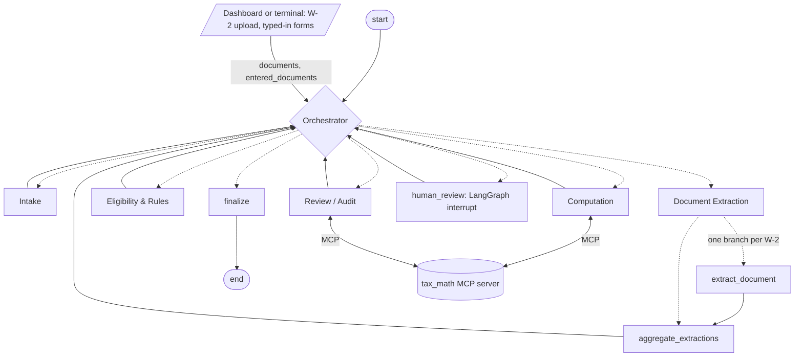

# SilverFile

A multi-agent preparation aid for Form 1040-SR, the U.S. Income Tax Return for Seniors (tax year
2025), built for Kushim. SilverFile gathers a client's information, drafts the return, and
records where every number came from so a person at Kushim can review it.

SilverFile never files anything and never gives tax advice. Anything out of scope, any conflict
between documents and answers, and any request for advice goes to a human.

## Status

| Component | Owner | In this repo |
|---|---|---|
| Orchestrator | Verena | Done: hub-and-spoke routing, task ledger, loop guard, human review step, graph wiring |
| Intake | Jordan | Done: one-question-at-a-time interview, corrections, resumable sessions, clarification requests from other agents, escalation detection |
| Document Extraction | Yassine | W-2 extraction agent done (LangGraph nodes, tests) |
| Eligibility & Rules | David | Done: decision table grounded in `data/policy.md`, LangGraph node, tests |
| Computation | Brendan | Done: `tax_math` MCP server and the Computation agent, tests |
| Review / Audit | Marco | Done: independent re-check of every computed line, 3-round revision loop, wired into the graph |
| Document registration, session runner, draft form, dashboard (`src/app/`) | Unassigned (written by Jordan during integration; see `docs/TEAM_REVIEW_SUMMARY.md`) | Done: W-2 upload, typed-in forms, terminal session, Streamlit dashboard, draft Form 1040-SR with click-through provenance |

## Team roles

| Focus area | Team member assigned |
|---|---|
| Agent memory | Jordan |
| Inter agent communication | Brendan |
| Task division and management | Verena |
| MLOps/DevOps | David |
| Guardrails and ethics | Marco |
| Security | Yassine |

## Setup

Requires Python 3.11 or newer (tested with 3.12 and 3.13).

```bash
python -m venv .venv
```

Activate it: `.venv\Scripts\activate` on Windows, or `source .venv/bin/activate` on macOS and
Linux. Then:

```bash
pip install -r requirements.txt
```

Copy `.env.example` to `.env`. Reading a W-2 image with the vision model needs
`ANTHROPIC_API_KEY` there. Everything else, including both eval cases with `--offline`, runs
without a key.

If `import pydantic` fails with `cannot import name 'ArgsKwargs'`, the virtual environment's
compiled files are damaged (seen once after copying a venv): delete `.venv` and create it again.

## Running

### The whole system

```bash
python run.py dashboard              # web dashboard: taxpayer view and Kushim preparer view
python run.py dashboard --offline    # same, reading the demo W-2s with the offline test reader
```

Open the URL it prints (default http://localhost:8501).

- **Taxpayer** view: upload W-2 images (JPG, PNG or WEBP), type in SSA-1099, 1099-INT, 1099-DIV
  and 1099-R boxes, then answer the questions one at a time. Note the session code to come back
  later: reopening it shows a summary of what was covered and continues at the same question.
- **Kushim preparer** view: every saved session and its state; the open issues of a paused
  session with the allowed decisions; the draft Form 1040-SR, where clicking any amount shows the
  tool that produced it, its inputs, the working, the source documents and the rule citations;
  and the audit record (task ledger, route taken, escalations, human decisions).

The same in a terminal:

```bash
python run.py session --session demo_1 --w2 demo/w2_image_1.jpg --forms demo/eval_case_1_forms.json --offline
python run.py review --session demo_1     # if the run pauses for a preparer
python run.py session --session demo_1 --offline   # carry on after the preparer decides
```

Leave out `--offline` to have the vision model read the W-2. `--answers FILE` answers the
questions from a file, one per line. The draft is written to `out/<session>_1040sr.html`.
Sessions are saved in `data/sessions.sqlite`; uploaded images in `data/uploads/` (both kept out
of git).

### Evaluation cases

- [demo/eval_case_1.md](demo/eval_case_1.md): a clean run to an approved draft.
- [demo/eval_case_2.md](demo/eval_case_2.md): a human-in-the-loop run (spouse died in 2025)
  and how to resolve it.

### Individual agents

```bash
python run.py tax-math-server                                    # tax_math MCP server on stdin/stdout
python data/generate_fixtures.py                                 # fake W-2 images
python run.py extract demo/w2_image_1.jpg demo/w2_image_2.jpg    # needs an API key in .env
python run.py extract demo/w2_image_1.jpg --offline              # no key needed
python run.py eligibility data/fixtures/eligibility_clean_mfj.json
python run.py eligibility data/fixtures/eligibility_spouse_died.json --resolve married_filing_jointly
python run.py intake --session demo_taxpayer_001                 # the interview on its own
```

`run.py intake` runs Intake's own graph. Use a different session ID from the full-system
sessions, because both use `data/sessions.sqlite` by default.

## Tests

```bash
python -m pytest
```

About 790 tests, no API key needed: `tax_math`, every agent, the full graph through the
Orchestrator (loop guard, bounded review loop, human review, resuming after a restart), the two
eval cases end to end, and the dashboard driven headlessly. See
[docs/INTEGRATION_TEST_REPORT.md](docs/INTEGRATION_TEST_REPORT.md) for the latest run.

## Orchestration

Hub and spoke: only the Orchestrator chooses the next step, and every agent hands control back
to it. All agents share one LangGraph state (`src/state.py`), checkpointed after every step
(`src/memory.py`), so a session can pause for a person or the taxpayer and resume later.



Dashed edges are conditional: the Orchestrator picks the first task whose inputs are ready, from
its task ledger. The graph shows the required patterns (specification section 4.1):

- **Conditional routing** from state (`task_ledger`, each agent's status), not a fixed sequence.
- **Parallel branch with aggregation**: one `extract_document` branch per W-2, merged by the
  `merge_extractions` and `merge_escalation_records` reducers.
- **Bounded cycle**: Review sends work back at most three times, then a person decides.
- **Loop guard**: a hand-off pattern repeated three times since a person last stepped in pauses
  the run for human review (`tests/orchestrator/test_graph.py`).

The Orchestrator's own notes explain the choice of topology:
[docs/IMPLEMENTATION_NOTES.md](docs/IMPLEMENTATION_NOTES.md#orchestrator-verena).

## Repository layout

```
├── README.md
├── requirements.txt
├── .env.example
├── run.py                       command-line entry point
├── pytest.ini
├── src/                         import root: code imports tax_math, state, agents.intake, ...
│   ├── state.py                 shared state and reducers
│   ├── graph.py                 LangGraph wiring
│   ├── memory.py                checkpointer and context-window strategy
│   ├── agents/                  the six agents
│   ├── app/                     document registration, session runner, draft form, dashboard
│   ├── security/                SSN validation, masking and redaction
│   └── tax_math/                deterministic 2025 arithmetic and its MCP server
├── data/
│   ├── generate_fixtures.py     fake W-2 images with ground-truth JSON
│   ├── policy.md                reference corpus: computation and eligibility rules
│   └── fixtures/
├── evals/cases.json             the two eval cases, machine-readable
├── tests/
├── traces/
├── docs/                        implementation notes, AI disclosure, metrics, integration reports
└── demo/                        eval cases, demo W-2 images, answer and form files
```

Still to add: `docs/graph.png`, `docs/metrics.md` numbers (context-window strategy) and the demo
video.

## More detail

- [docs/IMPLEMENTATION_NOTES.md](docs/IMPLEMENTATION_NOTES.md): how each component works.
- [data/policy.md](data/policy.md): the rules the agents cite.
- [docs/AI_DISCLOSURE.md](docs/AI_DISCLOSURE.md): how the team used AI.
- [docs/INTEGRATION_CHANGELOG.md](docs/INTEGRATION_CHANGELOG.md),
  [docs/INTEGRATION_TEST_REPORT.md](docs/INTEGRATION_TEST_REPORT.md),
  [docs/TEAM_REVIEW_SUMMARY.md](docs/TEAM_REVIEW_SUMMARY.md): the end-to-end integration work.
